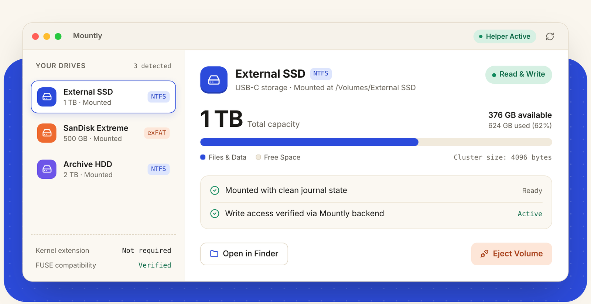

<div align="center">


# Mountly

**External drives, made accessible.**

A free, open source Mac app that lets you read and write to NTFS drives,<br>
check the state of every external drive, and eject safely.

[](https://github.com/kolapoimam/Mountly-App/actions/workflows/ci.yml)


[](LICENSE)

[**Download for Mac**](https://mountlyapp.vercel.app) · [Website](https://mountlyapp.vercel.app) · [Report a bug](https://github.com/kolapoimam/Mountly-App/issues/new?template=bug_report.yml) · [Request a feature](https://github.com/kolapoimam/Mountly-App/issues/new?template=feature_request.yml)

<br>



</div>

<br>

## Why Mountly

Plug a Windows formatted drive into a Mac and you can open your files, but you can't save, edit or delete anything. macOS only reads NTFS. The usual fixes are paid apps or Terminal commands.

Mountly gives you a simple window where you can see every drive you plug in, turn on write access for NTFS with one click, and eject without worrying about losing data.

## Features

- **Instant detection.** Drives show up the moment you plug them in, with no polling.
- **NTFS read and write.** Turn on write access for Windows drives without reformatting.
- **Clear drive status.** See if a drive is read only, writable, needs attention, or not supported. Mountly never guesses.
- **Verified writes.** Mountly runs a small test write before it tells you a drive is writable.
- **Copy, rename, delete.** Move files to and from a drive with progress, conflict handling and cancel.
- **Safe eject.** Eject one drive or all of them. Mountly won't eject while a copy is still running.
- **Menu bar access.** Check and eject drives from the menu bar.
- **Any brand.** Works the same for Samsung, SanDisk, WD, Seagate, LaCie, Kingston or a no name USB stick.

## Supported filesystems

| Filesystem | What Mountly does |
| --- | --- |
| NTFS | Read and write, after a one time setup of macFUSE and NTFS-3G |
| exFAT, FAT32 | Read and write using macOS's own support, checked automatically |
| APFS, HFS+ | Read and write using macOS's own support, checked automatically |
| ext4 and others | Detected and shown as limited support. Mountly won't offer write access it can't verify |

## Install

1. Download Mountly from the [website](https://mountlyapp.vercel.app).
2. Open **Mountly.dmg** and drag **Mountly** into **Applications**.
3. Open Mountly from Applications.
4. Plug in your drive.

If macOS says it can't check the app for malicious software, open **Applications**, right click **Mountly** and choose **Open**. You only need to do this once.

**For NTFS drives,** the first time you click **Enable Write Access**, Mountly walks you through installing two free, open source components.

- **macFUSE** lets macOS run filesystem drivers without a kernel extension. You approve it once in System Settings, Privacy & Security.
- **NTFS-3G** is the driver that writes to NTFS. Mountly installs it with Homebrew.

Other drives need no setup at all.

### Requirements

- macOS 14 Sonoma or later
- A Mac with Apple Silicon (M1, M2, M3 or M4)

## How it works

1. Mountly listens for drives through Apple's Disk Arbitration framework.
2. It reads each drive's filesystem and works out its state.
3. For exFAT, FAT32, APFS and HFS+, it checks that macOS has mounted the drive with write access.
4. For NTFS, it mounts the drive through NTFS-3G when you ask, using a small helper with only four allowed actions.
5. Before showing **Read & Write**, it writes, reads back and deletes a tiny test file.

The full reasoning, including why FSKit and FUSE-T were considered and not used, is in [docs/ARCHITECTURE.md](app/docs/ARCHITECTURE.md).

## Safety

Your files come first. Mountly:

- never formats, erases, partitions or repairs a drive
- never asks you to turn off System Integrity Protection
- won't force write access on a drive Windows left hibernated or not cleanly shut down
- only mounts external drives, and only under `/Volumes`
- talks to its helper only from a build signed by the same developer

Read the full model in [docs/SECURITY.md](app/docs/SECURITY.md).

## Build from source

You need Xcode 16 or later on an Apple Silicon Mac running macOS 14 or later.

```bash
git clone https://github.com/kolapoimam/Mountly-App.git
cd Mountly-App/app

swift build                            # build everything
swift test --filter MountlyCoreTests   # run the unit tests
swift run Mountly                      # run the app
```

`swift run` starts the app without its privileged helper, so NTFS write access won't work that way. To build a full app bundle and DMG:

```bash
./Scripts/build.sh      # clean build, unit tests, assemble Mountly.app
./Scripts/package.sh    # release build, sign if possible, create the DMG
```

See [app/docs/DEVELOPMENT.md](app/docs/DEVELOPMENT.md) and [app/docs/RELEASE.md](app/docs/RELEASE.md) for the details.

## Project structure

```
app/                     The Mac app (a Swift package)
  Sources/
    MountlyCore/         Drive detection, mounting, transfers, models. No UI code.
    Mountly/             The SwiftUI app.
    MountlyHelperTool/   The small privileged helper that mounts NTFS drives.
  Tests/                 Unit tests and NTFS integration tests.
  Resources/             Info.plist, entitlements and the helper's launchd file.
  Scripts/               Build, package, notarize and uninstall scripts.
  docs/                  Architecture, security, development and release guides.
src/, public/            The landing page at mountlyapp.vercel.app (React and Vite).
```

## Contributing

Contributions are welcome, whether you write Swift or not. Good places to start:

- Test Mountly with your own drives and report what works and what doesn't
- Improve error messages and help text
- Add tests to `MountlyCoreTests`
- Improve the website in `src/`
- Pick up an issue labelled **good first issue**

Please read the [contributing guide](CONTRIBUTING.md) before you open a pull request.

## Uninstall

```bash
cd app
./Scripts/uninstall.sh
```

This removes the app, its settings and its helper. It never touches your drives or files. macFUSE and NTFS-3G are separate installs. See [app/docs/TROUBLESHOOTING.md](app/docs/TROUBLESHOOTING.md) to remove them.

## Help

- [Troubleshooting guide](app/docs/TROUBLESHOOTING.md)
- [Open an issue](https://github.com/kolapoimam/Mountly-App/issues)
- [Report a security problem](SECURITY.md)

## Credits

Mountly is built and maintained by [Kolapo Imam](https://kolapo.ng). It relies on [macFUSE](https://github.com/macfuse/macfuse) and [NTFS-3G](https://github.com/tuxera/ntfs-3g) for NTFS support and uses the [Plus Jakarta Sans](https://github.com/google/fonts/tree/main/ofl/plusjakartasans) font. See [THIRD_PARTY_LICENSES.md](app/THIRD_PARTY_LICENSES.md).

Mountly is an independent project and is not affiliated with Apple, Microsoft or any drive maker.

## License

[MIT](LICENSE) © Kolapo Imam

<br>

<div align="center">

If Mountly saves you time, please give it a ⭐ on GitHub. It helps other Mac users find it.

</div>
